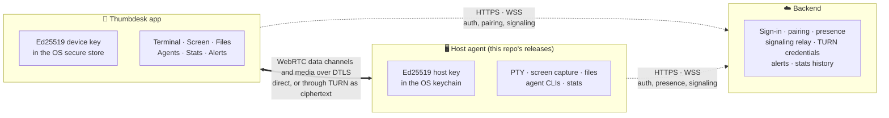
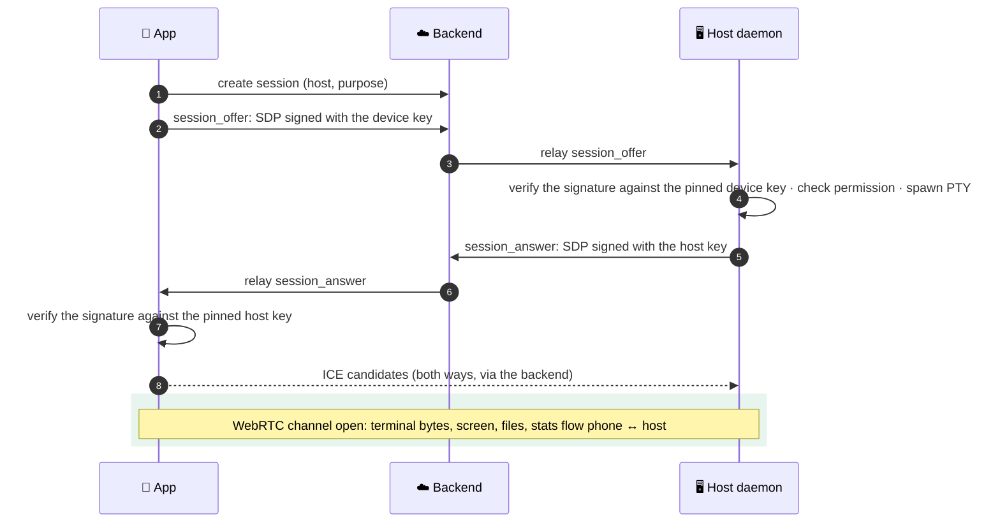

# Thumbdesk

> Your machines, from your phone: a real terminal, the screen, files and your coding agents.

Thumbdesk pairs your phone with the computers you care about: your dev box, a homelab Pi, a few servers. Once the host agent is paired, you can open a terminal, watch and control the screen, browse and edit files, check live stats, and pick up your Claude Code or Codex sessions, all from the app. Connections go directly between your phone and your machine over WebRTC where the network allows it, with both ends verifying each other's keys before anything flows.

**Get Thumbdesk:** [App Store](https://apps.apple.com/app/id6764135099) · [Google Play](https://play.google.com/store/apps/details?id=app.pocketshell.mobile) · [thumbdesk.com](https://thumbdesk.com/)

This repository is the releases channel for the **host agent**, the program that runs on the machine you want to reach. Every release here is built by the workflow in this repository, signed with Sigstore cosign, and published with its SHA-256 checksum. The install script, the Homebrew cask and the npm wrapper live here too, so you can read exactly what runs before you run it.

```
.github/workflows/  # builds, signs and publishes each release
crates/host-core/   # the published part of the agent's source, with its history (Apache-2.0)
docs/protocol.md    # how pairing, sessions and sealed signaling work, field by field
SECURITY.md         # how to report a vulnerability
homebrew/           # the Homebrew cask (published to yashagldit/homebrew-thumbdesk)
npm/thumbdesk/      # the `thumbdesk` npm wrapper
LICENSE.md          # the host agent's licence
```

Thumbdesk is built and run by one developer, Yash Agarwal. The full security design, including what each connection mode protects and what the backend handles, is written up at [thumbdesk.com/security](https://thumbdesk.com/security/). Questions and reports: support@thumbdesk.com.

---

## Install

Pick one. The older `pocketshell` command keeps working as an alias.

```bash
# Homebrew: macOS 13+ on Apple Silicon. Installs Thumbdesk.app and the command.
brew install --cask yashagldit/thumbdesk/thumbdesk

# Install script: macOS and Linux
brew install cosign   # optional, one time: enables signature verification
curl -fsSL https://thumbdesk.com/install.sh | bash

# npm: macOS, Linux and Windows
npm i -g thumbdesk
```

Then check it:

```bash
thumbdesk --version
```

**The install script** is short and readable at [thumbdesk.com/install.sh](https://thumbdesk.com/install.sh). It detects your OS and architecture, downloads the matching release from this repository, checks the SHA-256, and verifies the cosign signature when `cosign` is installed (it tells you if it is not). It installs to `~/.local/bin/thumbdesk`, or `/usr/local/bin` when run as root.

**npm** ships the binary in platform packages (`@thumbdesk/darwin-arm64`, `@thumbdesk/linux-x64-gnu`, `@thumbdesk/win32-x64-msvc`, and so on), selected by npm's `os`, `cpu` and `libc` filters. They are published from this repository's release workflow with [npm Trusted Publishing](https://docs.npmjs.com/trusted-publishers/), so each package carries build provenance you can inspect on npmjs.com. This is the recommended path on Windows.

**macOS** gets a notarized app. Thumbdesk.app holds the `thumbdesk` command, a menu-bar item showing the daemon's status and active shares, and the permission prompts screen sharing needs.

### Verify a release yourself

Every asset on the [Releases page](https://github.com/yashagldit/Thumbdesk/releases) has a `.sha256` and a `.cosign-bundle.json` next to it. The signature is keyless and bound to this repository's release workflow, so there is no key to leak and nothing to take on trust but GitHub's OIDC issuer:

```bash
cosign verify-blob \
  --new-bundle-format \
  --bundle pocketshell-v2.0.0-aarch64-apple-darwin.tar.gz.cosign-bundle.json \
  --certificate-identity-regexp '^https://github\.com/yashagldit/(PocketShell|Thumbdesk)/\.github/workflows/release-host-agent\.yml@refs/tags/v[0-9][0-9A-Za-z.-]*$' \
  --certificate-oidc-issuer https://token.actions.githubusercontent.com \
  pocketshell-v2.0.0-aarch64-apple-darwin.tar.gz
```

`thumbdesk update` runs the same checks (checksum, cosign signature, and the Apple Developer ID signature on a Mac) before it replaces anything. Asset names keep the `pocketshell-` prefix so that agents installed before the rename keep updating.

### Source

The part of the agent you would read to decide whether to trust it is published in [`crates/host-core/`](./crates/host-core/) under Apache-2.0, with its full history: the pairing proof and signaling cryptography, the backend client and every wire model, token refresh and secret storage, the state directory and config, the local audit log, and self-update verification. They are the files in the shipped builds, mirrored commit by commit from the private repository, so `git log` on a file shows what changed and when. [docs/protocol.md](./docs/protocol.md) walks through what they implement: every signed string, every check and its time window. The rest of the agent (terminal, screen, files, agents and the daemon itself), the mobile app and the backend are proprietary. Versions up to v1.1.0 (July 2026) are fully Apache-2.0 in [yashagldit/PocketShell](https://github.com/yashagldit/PocketShell).

---

## Pair and run

Pairing is a QR code shown on the host and scanned by the app, so your phone pins the host's public key from something displayed on the machine itself rather than from a field the backend relays. No passwords, no SSH keys, no inbound ports.

```bash
# 1. on the host, show the pairing QR
thumbdesk pair

# 2. in the app: Hosts → Add host → Scan Host QR

# 3. start the daemon as your user (installs a user service that starts at login)
thumbdesk daemon start
#    macOS: a LaunchAgent · Linux: a systemd user unit · Windows: a Task Scheduler task

# 4. status and logs
thumbdesk daemon status
journalctl --user -fu thumbdesk-host-agent                # Linux
log stream --predicate 'process == "thumbdesk"'          # macOS
```

The daemon connects out to the backend over WSS and waits. When your phone opens a session, both sides sign their WebRTC handshake with the long-term Ed25519 keys they pinned at pairing and check the other's signature before the channel carries a byte. Pairing a second phone shows a new QR with `thumbdesk pair`; `thumbdesk pair --reset` moves a host to a different account. `thumbdesk devices` lists and revokes trusted phones from the host side.

Useful commands:

```bash
thumbdesk rc            # start a named tmux session the app picks up (alias of `remote`)
thumbdesk expose 5173   # let the app preview a dev server on this port (deny-by-default)
thumbdesk hooks install # Claude Code, Codex and Grok hooks: push a notification when a run finishes
thumbdesk update        # update to the latest signed release
thumbdesk uninstall     # stop the service, revoke the host's token, delete keys, state and binaries
```

---

## What the app can do on a host

Each host keeps its own list of trusted phones with per-device permissions: **shell**, **files** and **stats**. The daemon checks the permission on every request, and a revoked phone is refused as soon as the host syncs its device list.

- **Terminal.** A real PTY in your shell, attachable to tmux and screen sessions. Sessions survive a dropped connection; the phone rejoins where it left off.
- **Screen.** Watch and control the desktop over WebRTC only (direct or TURN), so the picture never passes through our servers. It needs the OS's own permissions: Screen Recording and, for input, Accessibility on macOS; on Linux, the desktop portal asks the person at the screen the first time on GNOME and KDE Wayland; on Windows, Windows.Graphics.Capture. The menu-bar or tray item shows when a share is active and has an **Allow Screen Sharing** switch to turn sharing off for the host.
- **Files, projects and Git.** Browse, search, edit and transfer files; see status, diffs and history; stage, commit, pull and push. Large transfers run over WebRTC.
- **Coding agents.** Browse your Claude Code and Codex sessions on each host, resume one in a terminal, chat with a running agent from the app, and get a push notification when a run finishes (`thumbdesk hooks install`).
- **Dev-server preview.** Render a local Vite, Next.js, Rails or Django server in the app, with HMR and WebSockets, for ports you have exposed with `thumbdesk expose`.
- **Stats and alerts.** Live CPU, memory, disk, network, temperatures and the top 50 processes, with alert rules that push to your phone.

Alongside these, `thumbdesk` keeps a local audit log of pairings, approvals, revocations and sensitive operations (metadata only, never terminal contents), which you can read in the app.

---

## How it works

Two planes, kept apart. The **control plane** (HTTPS and WSS to the backend) carries sign-in, pairing, presence, session lifecycle and the WebRTC handshake. The **data plane** (WebRTC between phone and host, over DTLS) carries the terminal, the screen, files and full live stats, directly or through a TURN relay that only forwards ciphertext.



### Opening a session



Each signed SDP carries the signer's DTLS certificate fingerprint, a fresh nonce and a timestamp, so the transport key is bound to the pinned identity and a replayed or substituted handshake fails before the channel opens.

### What flows where

| Traffic | Path | Who can read it |
|---|---|---|
| Terminal, screen, files, full live stats | WebRTC, direct or via TURN | Only your phone and your host. TURN forwards DTLS ciphertext. |
| Terminal while WebRTC is connecting or unavailable | Signaling relay over TLS | Our servers, in transit only; not stored. Frames from the phone are signed and replay-checked. The app shows a **SIGNALING** badge. |
| Screen sharing | WebRTC only | If the network blocks both direct and TURN paths, screen sharing is unavailable rather than relayed. |
| File operations over signaling | Sealed with ChaCha20-Poly1305 under an X25519/HKDF key | Only your devices. If that key exchange fails, the app can fall back to TLS only for small operations; large transfers require WebRTC. |
| Agent chat | Sealed the same way over signaling | Only your devices with current agents. The app labels an older host agent's connection "Not end-to-end encrypted". |
| Presence and lightweight stats | WSS to the backend | Our backend: session count, agent version, which coding-agent CLIs are installed, whether screen capture is available, and numeric metrics (CPU, memory, swap, disk, uptime, load, battery, network and disk I/O, temperature). Minute aggregates are kept for the history charts. |
| Crash reports | HTTPS to the backend | Our backend, with no terminal data. On by default; `thumbdesk diagnostics off` turns them off. |

Process lists, command lines, logged-in users and network connections are shown live over WebRTC only and are never stored by us. The full list of what the backend keeps, and for how long, is in [section 7 of the security page](https://thumbdesk.com/security/#what-we-see) and the [privacy policy](https://thumbdesk.com/privacy/).

---

## Security model

| Layer | What |
|---|---|
| Identity | Long-term Ed25519 keys, one per host and one per phone, pinned against each other at pairing |
| Handshake | Ed25519-signed SDP with nonce and timestamp, binding the DTLS certificate fingerprint to the pinned key |
| Data plane | WebRTC data channels and media over DTLS |
| Sealed signaling | ChaCha20-Poly1305, keys from an ephemeral X25519 exchange and HKDF-SHA256, domain-separated |
| TURN | Short-lived credentials issued per account; forwards ciphertext it cannot read |
| Secrets at rest | Host key and refresh token in the OS keychain (macOS Keychain, Windows Credential Manager, Linux Secret Service), with an owner-only file fallback on headless Linux; phone keys in the iOS Keychain or Android Keystore |
| Releases | Sigstore cosign keyless signatures bound to this repository's workflow, SHA-256 checksums, notarized macOS app, npm provenance |

**Host-to-host transfers** (Pro) use the phone as introducer: it signs an attestation binding both hosts' public keys to one transfer id, with a short expiry, and each host verifies it against the phone key it pinned at pairing. The backend relays the handshake but cannot substitute a peer.

### Scope, by design

- **No approval tap per session.** Once a phone is trusted, it opens sessions without a prompt on the host, including screen sharing where the OS has granted it. The controls are device approval, biometric lock in the app, remote revocation from any paired device or `thumbdesk devices revoke`, the host's Allow Screen Sharing switch, and the audit log.
- **Your account's privileges.** A phone with the shell permission does what your user can do on that machine, sudo included.
- **Pairing and new sessions need our backend.** An outage can delay opening a session; an open terminal stays attached through a short one, and you always have local access to your machine.
- **Windows builds are verified by cosign and npm provenance** rather than an Authenticode certificate for now, so SmartScreen may ask once on first run.
- **Reviewed internally; an independent audit is on the list** and has not yet been commissioned.

Found something? See [SECURITY.md](./SECURITY.md): email support@thumbdesk.com with "Security" in the subject, and we reply within five business days.

---

## Feedback

Issues for the host agent are welcome here. For the app or your account, write to support@thumbdesk.com.

## License

The Thumbdesk host agent is proprietary software; see the [licence agreement](./LICENSE.md) and the [Terms of Service](https://thumbdesk.com/terms/). It includes open-source components that remain under their own licences.
